# Network Traffic Analysis Using Wireshark

## Project Description
A hands-on project involving network traffic capture and packet analysis using Wireshark.

## Tools Used
- Wireshark
- Windows PowerShell

## Project Files
- `capture_properties.png`
- `dns_general.png`
- `dns_github_query.png`
- `expert_info.png`
- `http_filter.png`
- `http_stream.png`
- `icmp_echo.png`
- `icmp_filter.png`
- `lab_capture.pcapng`
- `powershell_commands.png`
- `protocol_hierarchy.png`
- `tls_client_hello.png`
- `wifi_live_capture.png`

## Analysis Performed
- Live packet capture
- DNS analysis
- HTTP filtering and stream inspection
- ICMP packet analysis
- TLS Client Hello inspection
- Protocol hierarchy and network conversations
- Expert information review

## Learning Outcomes
- Understanding network protocols
- Inspecting captured packets
- Practising basic network troubleshooting
## Screenshots

## Screenshots

### Live Network Capture
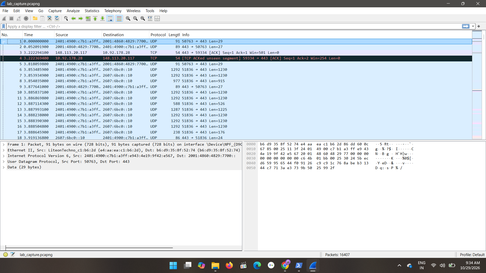

### Capture Properties
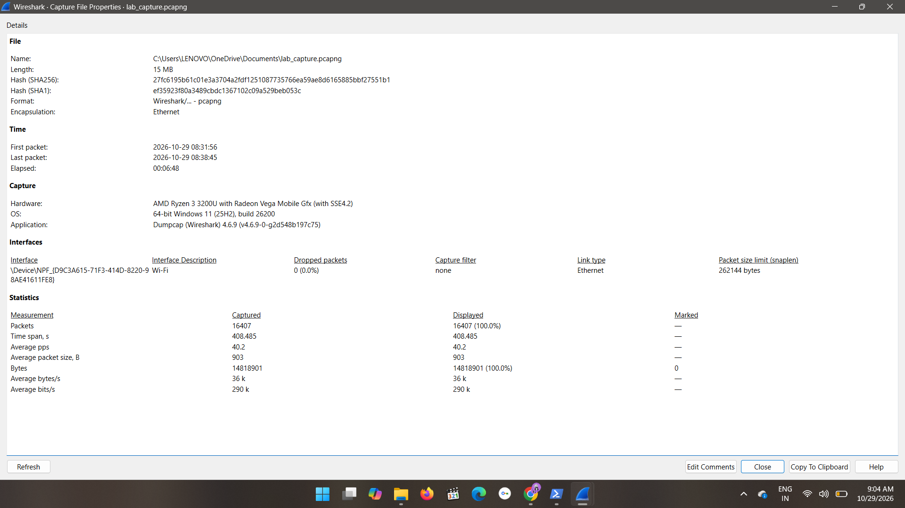

### Protocol Hierarchy
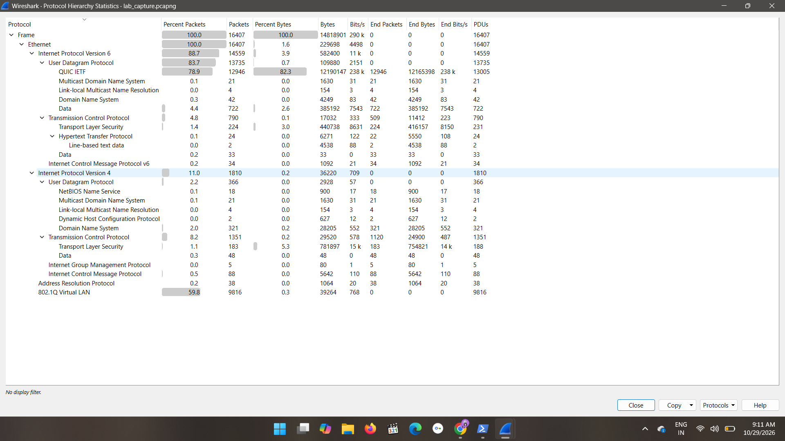

### DNS Analysis
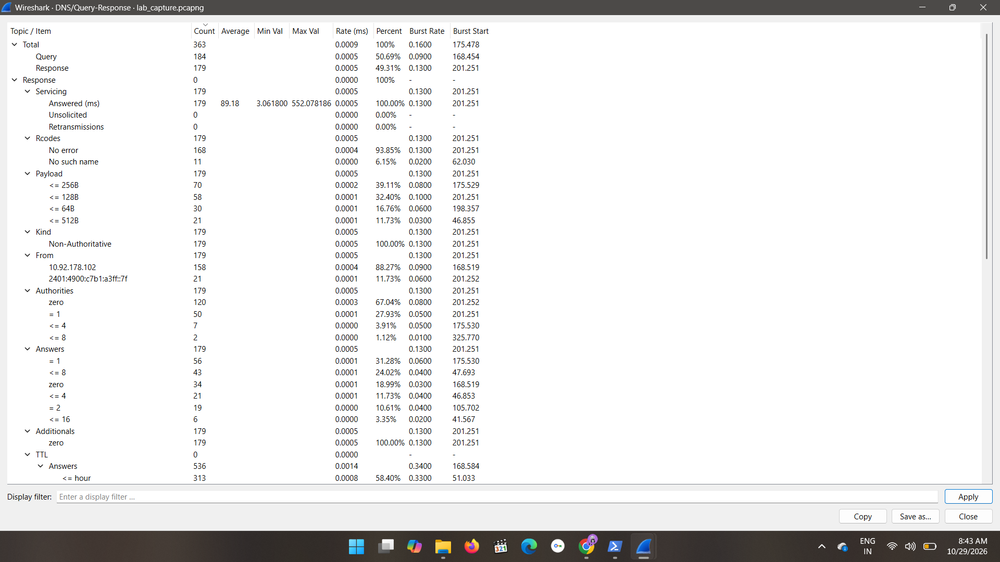

### DNS GitHub Query
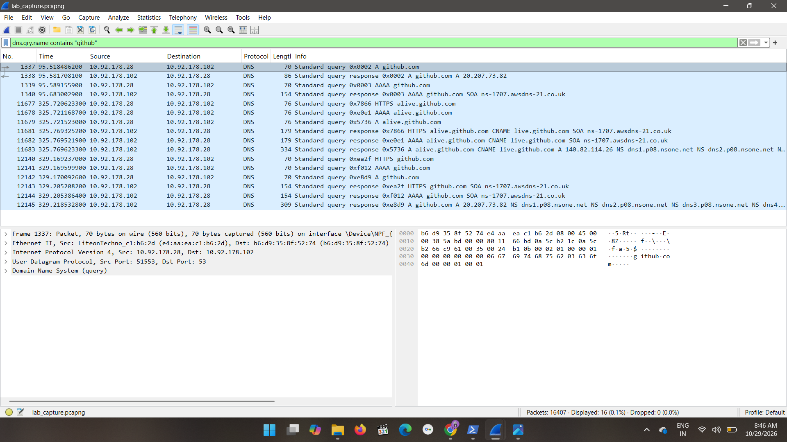

### HTTP Filter

### HTTP Stream
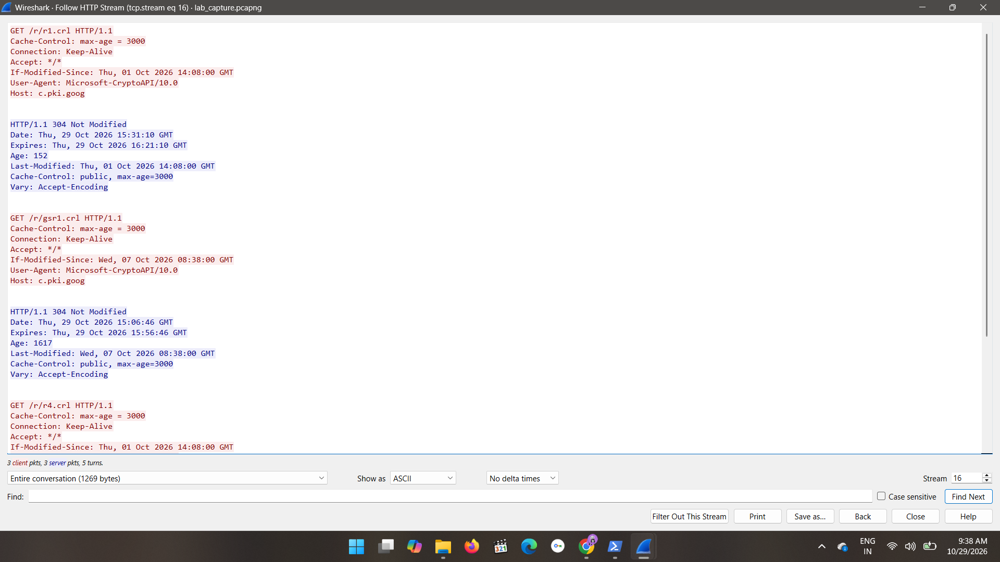

### ICMP Filter
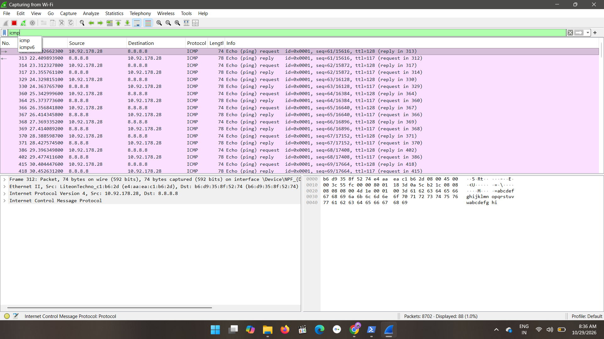

### ICMP Echo
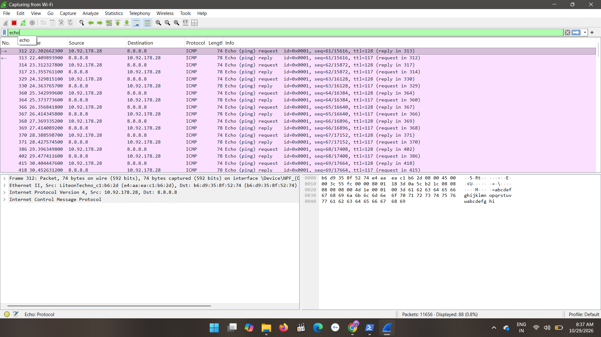

### TLS Client Hello
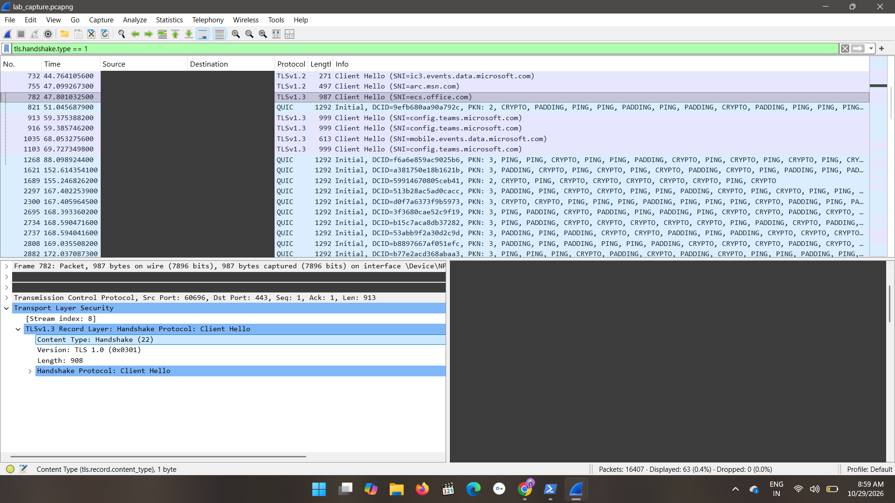

### Expert Information
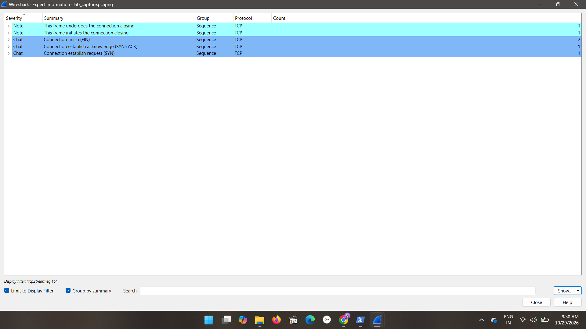

### PowerShell Commands
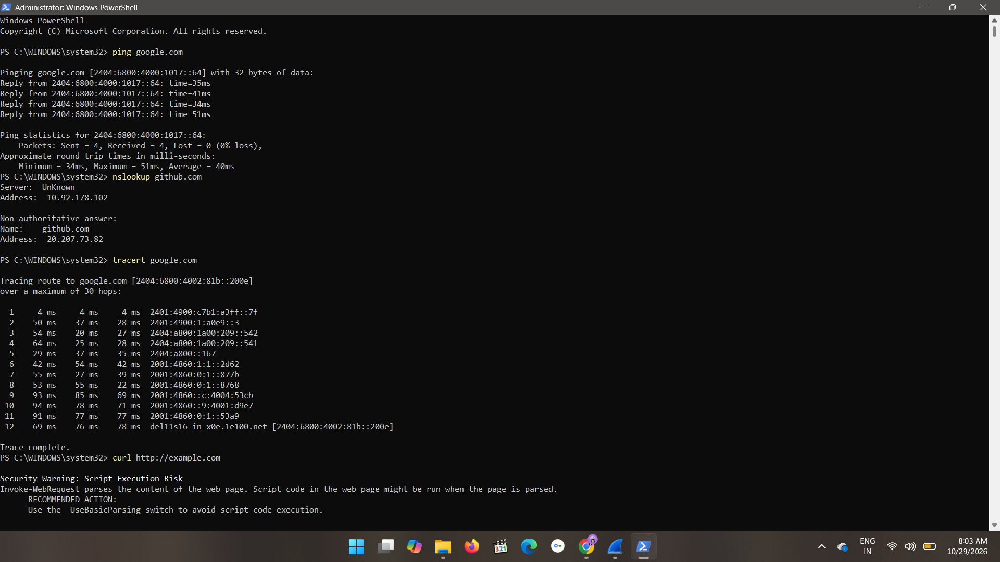

## Key Findings

- Identified protocols using Wireshark's Protocol Hierarchy.
- Examined DNS traffic and domain query information.
- Applied HTTP filters to inspect relevant packets and streams.
- Analysed ICMP traffic to understand network diagnostic packets.
- Inspected TLS Client Hello packets to observe connection setup information.
- Reviewed Expert Information to identify potential network issues.

## Conclusion

This project provided practical experience in network traffic capture, packet inspection, protocol analysis, and basic network troubleshooting using Wireshark.

## Author

Cybersecurity learner | Network Traffic Analysis
